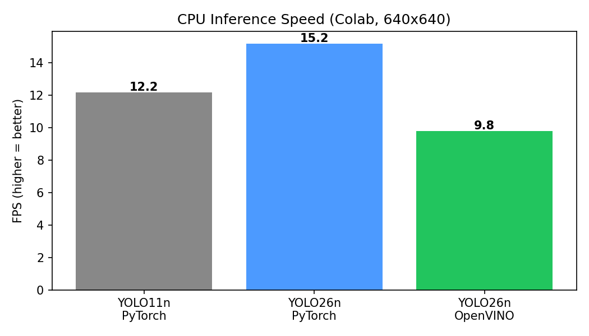

# yolo26-edge-tracking

### 🚀 NMS-free detection • 🎯 Multi-object tracking • ⚡ Edge CPU optimized

---

## 📌 Overview
A real-time object detection and tracking system built with **Ultralytics YOLO26**, designed to run on a normal **CPU** (no GPU needed). The model is exported to **OpenVINO** and benchmarked against YOLO11 to measure the speed gain.

## 🎬 Demo
▶️ **[Watch the demo video](output_tracked.mp4)** (click, then press play)

Each object gets a **box, class name, confidence score, unique tracking ID and movement trail**, with a live HUD showing FPS and unique object counts.

## ✨ Features
- NMS-free inference with YOLO26 (direct final predictions)
- Multi-object tracking with **ByteTrack** (persistent IDs)
- Custom OpenCV overlay: boxes, labels, trails, live FPS and unique counts
- OpenVINO export for edge CPU deployment
- Latency and FPS benchmark: YOLO11n vs YOLO26n vs YOLO26n (OpenVINO)

## 📊 Benchmark Results
Tested on a Google Colab CPU (Intel Xeon @ 2.20GHz), 640x640 input.

| Model | Latency (ms) | FPS |
|---|---|---|
| YOLO11n (PyTorch) | 197.9 | 5.1 |
| YOLO26n (PyTorch) | 180.1 | 5.6 |
| **YOLO26n (OpenVINO)** | **158.7** | **6.3** |

- YOLO26n vs YOLO11n (PyTorch): **~9% faster**
- OpenVINO vs PyTorch (YOLO26n): **~12% faster**
- YOLO26n OpenVINO vs YOLO11n PyTorch: **~20% faster**

> Ultralytics reports up to 43% faster CPU inference for YOLO26. My numbers are lower because Colab has a weak, shared 2-core CPU and I tested with a single input image. Results vary by hardware.

## 🛠️ Tech Stack
`Python` • `Ultralytics YOLO26` • `ByteTrack` • `OpenCV` • `PyTorch` • `OpenVINO` • `Google Colab`

## ▶️ How to Run
1. Open `YOLO26_Edge_Tracking.ipynb` in Google Colab
2. Set runtime to **CPU**
3. Run the cells in order: install, upload a video, track, benchmark

## ⚠️ Limitations
- The pretrained model detects only the **80 COCO classes** (no watch or cap). Custom training is needed for other objects.
- The test video is **AI-generated** with slight camera motion and motion blur, so some **ID switches** happen and unique counts can be inflated.
- Colab CPU numbers are not the same as real edge devices.

## 🔮 Future Work
- Vehicle counting with a line-crossing zone
- Custom-trained model (my Roboflow dataset)
- Deploy on Raspberry Pi

## 👩‍💻 Author
**Lathika SK**, B.Tech AI & Data Science
[GitHub](https://github.com/lathika-sk) • [LinkedIn](https://www.linkedin.com/in/lathika-sk)
